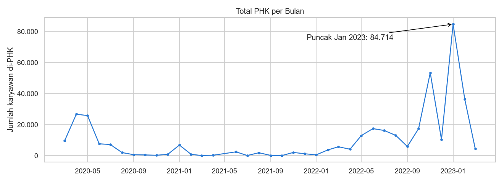
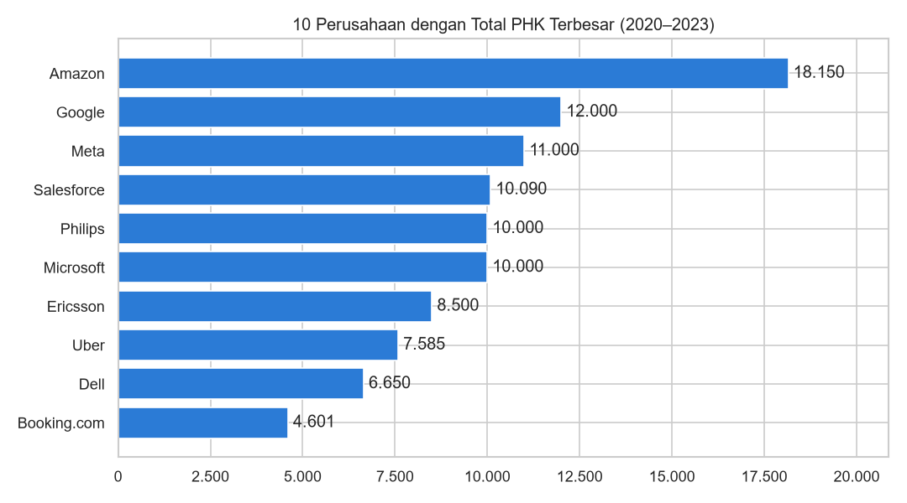
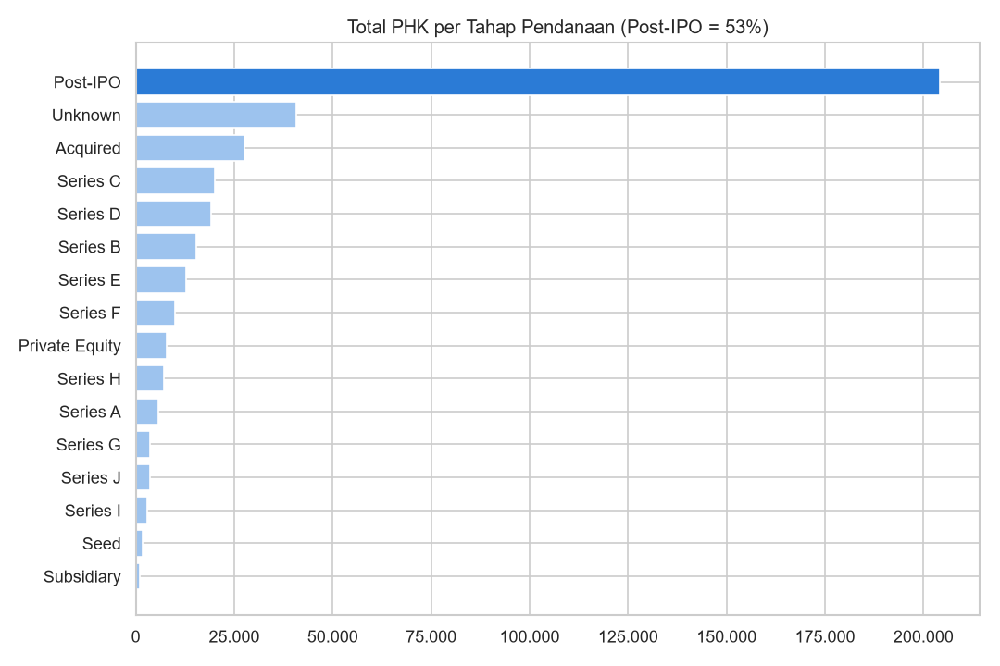
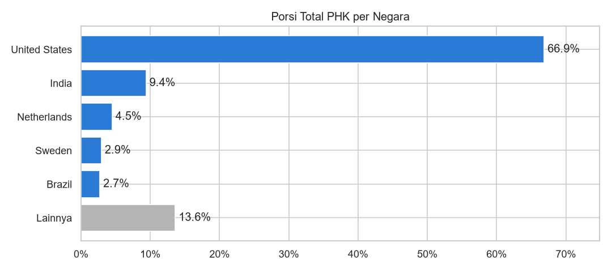
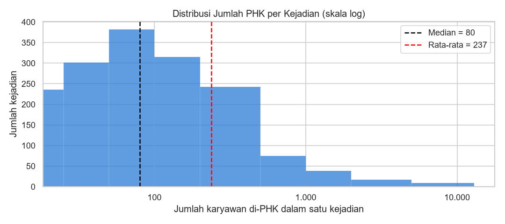

# PHK Perusahaan Teknologi Global 2020–2023: Data Cleaning & EDA dengan Python

Kapan gelombang PHK memuncak, siapa yang paling terdampak, dan seberapa besar PHK yang "biasa" terjadi?
Proyek ini membersihkan dan menganalisis 2.361 kejadian PHK (Maret 2020 – Maret 2023) dengan **pandas**, lalu menyajikan temuannya dalam grafik.

Data yang sama sudah saya olah dengan MySQL di [Proyek 2: sql-world-layoffs](https://github.com/DEWI1717/sql-world-layoffs). Hasil cleaning di kedua proyek identik (**1.995 baris**), jadi proyek ini juga menunjukkan cara menerjemahkan SQL ke pandas.

**Tools:** Python 3.11 · pandas · matplotlib · seaborn · Jupyter (VS Code)

**Notebook lengkap:** [`Analisis-Layoffs.ipynb`](Analisis-Layoffs.ipynb) (bisa dibaca langsung di GitHub, lengkap dengan grafiknya)

---

## Data cleaning
| Langkah | Yang dilakukan | Pandas | Baris |
|---|---|---|---|
| 1 | Hapus duplikat | `drop_duplicates()` | 2.361 → 2.356 |
| 2 | Rapikan spasi, satukan "Crypto*", buang titik di "United States.", ubah tanggal | `str.strip()`, `str.startswith()`, `str.rstrip()`, `pd.to_datetime()` | 2.356 |
| 3 | Isi `industry` kosong dari baris lain perusahaan yang sama (Airbnb, Juul, Carvana); Bally's Interactive dibiarkan kosong | `groupby().transform("first")` + `fillna()` | 2.356 |
| 4 | Hapus baris tanpa jumlah **dan** persentase PHK | `dropna(how="all")` | 2.356 → **1.995** |

## Temuan

### 1. PHK memuncak di Januari 2023

Gelombang kedua (akhir 2022 – awal 2023) jauh lebih besar dari gelombang awal pandemi. Januari 2023 saja: **84.714 orang**. Data 2023 baru sampai 6 Maret, tetapi totalnya (125.677) sudah mendekati seluruh 2022 (160.661).

### 2. Perusahaan raksasa dan yang sudah IPO paling banyak mem-PHK

Amazon (18.150), Google (12.000), dan Meta (11.000) di urutan teratas. Perusahaan **Post-IPO menyumbang 53%** dari seluruh PHK.

### 3. Amerika Serikat menyumbang dua pertiga PHK

**66,9%** PHK terjadi di AS, disusul India (9,4%) dan Belanda (4,5%). Industri paling terdampak: Consumer (45.182) dan Retail (43.613).

### 4. Kebanyakan PHK berskala kecil

**Median hanya 80 orang** per kejadian, sedangkan rata-ratanya 237 karena tertarik ke atas oleh segelintir PHK raksasa. Hampir 4 dari 5 kejadian (79%) melibatkan 200 orang atau kurang.

Selain itu, ada **116 perusahaan yang tutup** (PHK 100%), termasuk Britishvolt (modal USD 2,4 miliar) dan Quibi (USD 1,8 miliar).

## Keterbatasan
Layoffs.fyi dikumpulkan dari berita, jadi PHK yang tidak diberitakan (terutama di luar AS) mungkin tidak tercatat. 361 baris dihapus karena tidak punya angka PHK sama sekali.

## Struktur file
| File | Isi |
|---|---|
| `Analisis-Layoffs.ipynb` | Notebook: cleaning + 7 pertanyaan EDA + kesimpulan |
| `data/layoffs_raw.csv` | Data mentah (sumber: [Alex The Analyst](https://github.com/AlexTheAnalyst/MySQL-YouTube-Series), aslinya dari Layoffs.fyi) |
| `gambar/` | Grafik yang dipakai di README ini |

**Menjalankan ulang:** `pip install pandas matplotlib seaborn jupyter`, lalu buka notebook dan pilih *Run All*.
